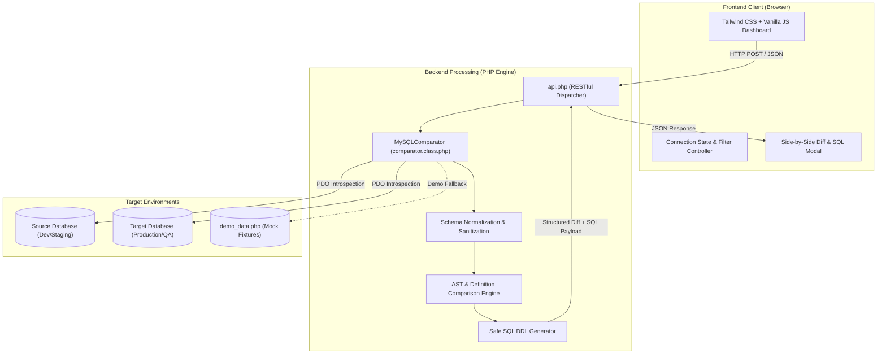

<div align="center">

# ⚡ DbDiff

**A fast, zero-dependency schema comparison engine & automated DDL migration generator for MySQL & MariaDB.**

[](https://www.php.net/)
[](https://www.mysql.com/)
[](https://mariadb.org/)
[](https://tailwindcss.com/)
[](LICENSE)
[]()

<br />

[Explore Features](#-key-features) •
[Architecture](#-system-architecture) •
[Quick Start](#-quick-start) •
[Usage Guide](#-usage--workflow) •
[Engineering Highlights](#-engineering-highlights) •
[Roadmap](#-roadmap)

</div>

---

## 📖 What is DbDiff?

Every developer knows the pain of database schemas falling out of sync between **Local**, **Development**, **Staging**, and **Production** environments. When a deployment fails or a query breaks because a column or index is missing on remote, manually inspecting tables and drafting `ALTER TABLE` statements is tedious, stressful, and error-prone.

**DbDiff** is a developer-first utility designed to solve this in seconds:
- **Zero Configuration & Zero Dependencies:** Runs on pure PHP with native PDO—no Node.js build steps, heavy frameworks, or binary installations.
- **Deep Schema Introspection:** Accurately compares tables, columns, data types, nullability, defaults, extra attributes, collations, primary keys, composite indexes, foreign keys, and views/routines.
- **Automated Safe DDL:** Generates copy-paste ready `ALTER TABLE` and `CREATE TABLE` scripts with precise column positioning (`AFTER ...`) and commented safety safeguards for drops.

---

## 🌟 Key Features

### 1. Dual-Host Live Probing & Connection Manager
- **Side-by-Side Verification:** Test source and target servers simultaneously with real-time TCP latency pings (ms) and database engine version detection.
- **Dynamic Database Dropdown:** 1-click fetch to discover and list all available databases on the host.
- **Instant Direction Swap:** One-click button to flip Source $\leftrightarrow$ Target parameters.
- **Session Memory:** Optional browser-side credential remembering for frequent local/staging diffs.

### 2. Fine-Grained Schema Diff Engine
- **Table Differences:** Instantly groups tables into Missing, Extra, Modified, or Identical.
- **Column-Level Precision:**
  - Type & length mismatches (e.g., `VARCHAR(50)` vs `VARCHAR(255)`, `DECIMAL(10,2)` vs `DECIMAL(12,2)`).
  - Nullability changes (`NULL` vs `NOT NULL`), default values, and column comments.
  - Column attributes: `AUTO_INCREMENT`, `ON UPDATE CURRENT_TIMESTAMP`, and generated virtual columns.
  - Character set and collation mismatches.
- **Primary & Composite Indexes:**
  - Type checking (`PRIMARY`, `UNIQUE`, `INDEX`, `FULLTEXT`).
  - Column sequence verification in multi-column composite indexes.
- **Foreign Key Constraints:**
  - Referenced table/column verification with `ON DELETE` / `ON UPDATE` cascade rules.
- **Views & Stored Routines:**
  - Full structural comparison for Views, Triggers, and Stored Procedures.

### 3. Safe Migration SQL (DDL) Generator
- **Auto-generates Ready-to-Run SQL:**
  - `CREATE TABLE` scripts for tables missing in target.
  - `ALTER TABLE ... ADD COLUMN ... AFTER ...` preserving physical column sequence.
  - `ALTER TABLE ... MODIFY COLUMN ...` preserving nullability, defaults, and collations.
  - `ALTER TABLE ... ADD / DROP INDEX` and foreign key synchronization.
- **Safe Destructive Safeguards:** Dropping columns or tables is never executed blindly; all destructive commands are wrapped in explicit, commented warning blocks.
- **One-Click Export:** Copy individual table scripts or download the complete consolidated `.sql` migration file.

### 4. Interactive Modern Dashboard & Instant Demo Fixtures
- **Clean UI:** Responsive interface built with Tailwind CSS, KPI statistic cards, search filters, and expandable side-by-side diff viewers.
- **1-Click Demo Mode:** Bundled with realistic schema fixtures allowing anyone to test and explore the entire tool immediately without connecting a live database.

---

## 🏗️ System Architecture



---

## 💻 Tech Stack

| Layer | Technology | Details |
|---|---|---|
| **Backend** | PHP 7.4 / 8.0+ | Object-Oriented, PDO drivers, strict error handling |
| **Database** | MySQL / MariaDB | MySQL 5.7+, MySQL 8.x, MariaDB 10.3+ |
| **Frontend** | Vanilla JavaScript (ES6+) | Asynchronous Fetch API, reactive DOM updates |
| **Styling** | Tailwind CSS & FontAwesome | Responsive mobile-first layout, sleek developer aesthetic |
| **Data Format** | JSON / SQL | RESTful JSON exchange, standard ANSI/MySQL DDL |

---

## 🚀 Quick Start

### Prerequisites
- PHP `>= 7.4` (Compatible with PHP 8.0, 8.1, 8.2, 8.3)
- PHP Extensions: `pdo`, `pdo_mysql`, `json`
- MySQL or MariaDB instance (or use the built-in 1-Click Demo Mode)

### Option 1: Built-in PHP Server (Zero Setup)

Clone the repository and spin it up with one command:

```bash
# 1. Clone the repository
git clone https://github.com/your-username/db-diff.git
cd db-diff

# 2. Start the built-in PHP server
php -S localhost:8000

# 3. Open in your browser
# Visit: http://localhost:8000
```

*(Or run via Composer: `composer serve`)*

### Option 2: Apache / Nginx

Copy the files directly to your web server document root:

```bash
# For Apache on Linux:
sudo cp -r . /var/www/html/db-diff
sudo chown -R www-data:www-data /var/www/html/db-diff

# Visit: http://localhost/db-diff/
```

### Option 3: Docker Run

Run quickly using the official PHP Docker image:

```bash
docker run -d -p 8000:80 \
  --name db-diff \
  -v "$PWD":/var/www/html \
  php:8.2-apache
```

---

## 🛠️ Usage & Workflow

```
┌──────────────────────────────────────────────────────────┐
│ 1. Enter Credentials  ➜  2. Test Ping  ➜  3. Pick Schema │
└────────────────────────────┬─────────────────────────────┘
                             │
                             ▼
┌──────────────────────────────────────────────────────────┐
│ 4. Configure Flags (Ignore Collation, Widths, Routines)  │
└────────────────────────────┬─────────────────────────────┘
                             │
                             ▼
┌──────────────────────────────────────────────────────────┐
│ 5. Review Diff Matrix ➜ 6. Inspect & Export Sync SQL DDL │
└──────────────────────────────────────────────────────────┘
```

1. **Configure Connection Parameters**:
   - Enter Host/IP, Port, Username, and Password for both **Source** (reference schema) and **Target** (database to update).
   - Click **Test Connection** on both sides to check latency and fetch available databases.
2. **Set Comparison Flags**:
   - `Ignore Integer Display Width`: Safely handles MySQL 8.0+ integer display width deprecation (e.g. `int(11)` vs `int`).
   - `Ignore Collation Differences`: Filters out non-breaking collation variances.
   - `Ignore Column Comments`: Skips developer comment modifications.
   - `Include Views, Triggers, Routines`: Compares views and stored routines.
3. **Execute Comparison**:
   - Click **Compare Databases** (or click **Try Demo Mode** for an instant sample test).
4. **Inspect & Export Synchronization DDL**:
   - Filter tables using the status KPI badges (`Missing in Target`, `Modified`, `Identical`, `Extra in Target`).
   - Expand any row to review granular column-by-column side-by-side diffs.
   - Click **Generate Sync SQL** to view, copy, or download the migration script.

---

## 🔒 Safety & Non-Destructive Principles

- **Read-Only Metadata Queries:** DbDiff only queries `SHOW CREATE TABLE`, `information_schema`, and `SHOW FULL COLUMNS`. It never modifies either database during comparison.
- **Commented Destructive Statements:** Any potentially destructive action (`DROP TABLE`, `DROP COLUMN`) is commented out with safety warnings:
  ```sql
  -- CAUTION: Destructive operation. Uncomment only if verified:
  -- ALTER TABLE `orders` DROP COLUMN `legacy_token`;
  ```
- **Identifier Quoting:** Table and column identifiers are safely escaped with backticks to prevent syntax errors with reserved keywords.
- **Zero Credential Storage:** Database passwords stay in the browser session and are never written to disk or logs.

---

## 📁 Repository Structure

```
db-diff/
├── api.php                  # RESTful API controller & AJAX request dispatcher
├── comparator.class.php     # Core schema introspection & DDL synthesis engine
├── composer.json            # Project definition & quick-start scripts
├── demo_data.php            # Built-in realistic schema fixtures for Demo Mode
├── index.php                # Responsive single-page UI (Tailwind CSS + JS)
├── .gitignore               # Standard git exclusions for credentials & logs
├── LICENSE                  # MIT Open Source License
└── README.md                # Documentation, architecture guide & quick start
```

---

## 🎯 Engineering Highlights

- **Complex Schema AST Normalization:** Smooths over engine quirks between MySQL 5.7, MySQL 8.0, and MariaDB (integer display width deprecation, collation defaults, and generated column syntax).
- **Physical Column Position Resolution:** Automatically calculates topological positions for missing columns and appends precise `AFTER ` clauses to mirror target schemas.
- **Dependency Ordering:** Generates primary keys and indexes before dependent foreign key constraints.
- **Zero-Dependency Lightweight Architecture:** Implements a full-featured developer utility using clean, maintainable object-oriented PHP and native PDO without heavy framework baggage.

---

## 🗺️ Roadmap

- [ ] **Headless CLI Mode:** Standalone command-line runner (`php dbdiff.php --src=... --tgt=... --output=patch.sql`) for terminal power users.
- [ ] **GitHub Actions Schema Drift Check:** Automated schema drift detection triggered on pull requests.
- [ ] **PostgreSQL Support:** Extend the core comparator engine to support PostgreSQL schema comparisons.
- [ ] **Data Diff Engine:** Optional checksum-based row comparison for lookup and configuration tables.

---

## 🤝 Contributing

Contributions, bug reports, and feature requests are welcome!
Feel free to open an issue or submit a pull request:

1. Fork the Project
2. Create your Feature Branch (`git checkout -b feature/AmazingFeature`)
3. Commit your Changes (`git commit -m 'Add some AmazingFeature'`)
4. Push to the Branch (`git push origin feature/AmazingFeature`)
5. Open a Pull Request

---

## 📄 License

Distributed under the **MIT License**. See [`LICENSE`](LICENSE) for more information.

<div align="center">
<sub>Built with precision for Developers, DBAs, and DevOps Engineers.</sub>
</div>
